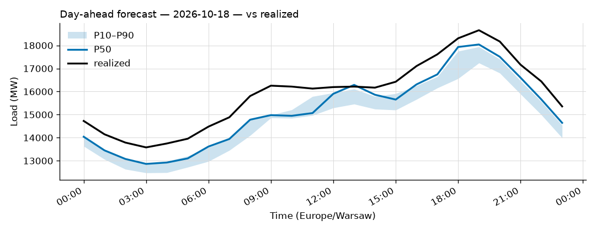
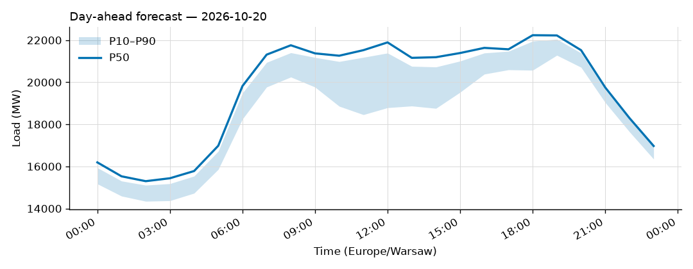
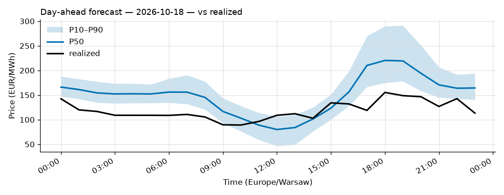
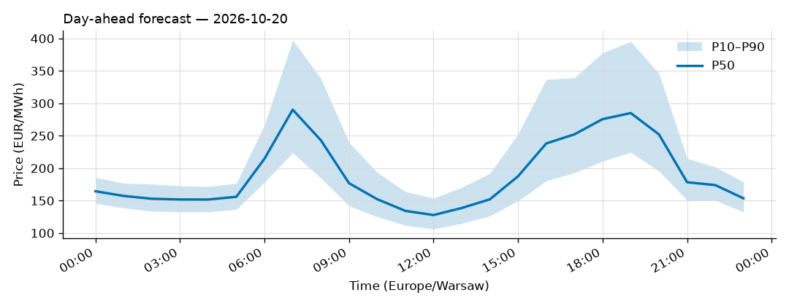

# Daily forecast report — 2026-10-19

Model: seasonal naive — **BASELINE**, not the final model. P50 copies the same hour 7 days ago; the band is the spread of the last 4 weeks. Serves until a trained model earns promotion (see docs/PLAN.md M4, UAT rules M9).

## Yesterday (2026-10-18) — how did we do?

| Forecast | MAPE |
|---|---|
| Ours (naive, incumbent) | 4.72% |
| Challenger (ridge+TSO, shadow) | n/a |
| TSO day-ahead | 2.18% |

## Tomorrow (2026-10-20) — the forecast

- Expected peak: **22,236 MW** around 18:00 local time.
- Daily range (P50): 15,300 – 22,236 MW.
- Uncertainty band at peak: 20,571 – 21,954 MW (P10–P90).

### Top drivers (plain words)

1. Same hour last week. The naive model copies it.
2. Day of week: tomorrow is a Tuesday.
3. Warsaw temperature tomorrow: 7 to 12 °C (not yet used by the model).

### Oddities

- Challenger shadow started today; first score tomorrow.
- Price: RES forecast for 2026-10-20 not yet published (24 h persisted from the day before).

## Price — day-ahead (LEAR, shadow)

### Yesterday (2026-10-18) — forecast vs realized

| Model | MAE (EUR/MWh) |
|---|---|
| LEAR (incumbent) | 37.42 |
| LightGBM+conformal (shadow) | 46.46 |
| naive-1d | 58.19 |

### Tomorrow (2026-10-20) — the price forecast

- Expected peak price: **290 EUR/MWh** around 07:00 local.
- P50 range: 128 – 290 EUR/MWh; band at peak 224 – 398.

_Full hourly quantiles: see `data/forecasts/`._
