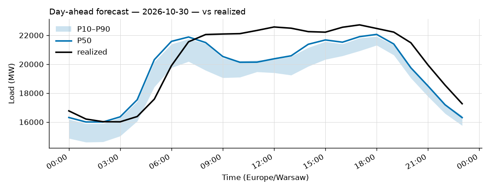
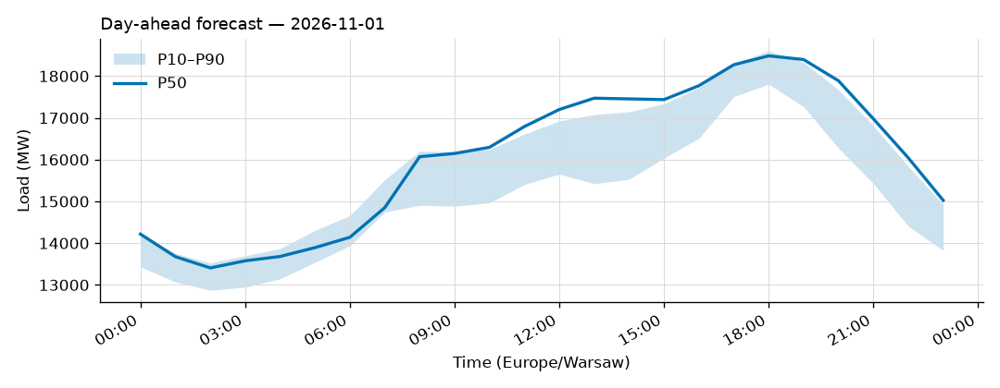
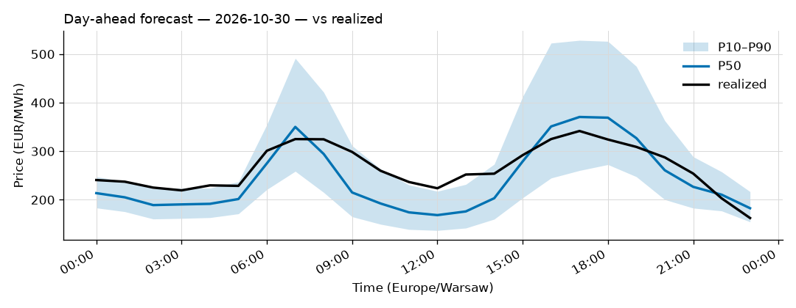
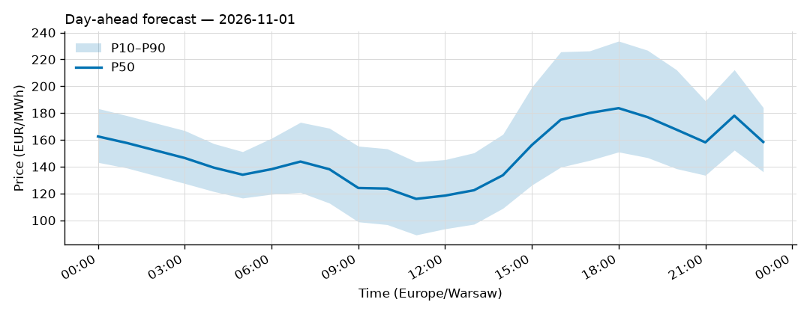

# Daily forecast report — 2026-10-31

Model: seasonal naive — **BASELINE**, not the final model. P50 copies the same hour 7 days ago; the band is the spread of the last 4 weeks. Serves until a trained model earns promotion (see docs/PLAN.md M4, UAT rules M9).

## Yesterday (2026-10-30) — how did we do?

| Forecast | MAPE |
|---|---|
| Ours (naive, incumbent) | 5.57% |
| Challenger (ridge+TSO, shadow) | 0.86% |
| TSO day-ahead | 1.82% |

## Tomorrow (2026-11-01) — the forecast

- Expected peak: **18,484 MW** around 18:00 local time.
- Daily range (P50): 13,407 – 18,484 MW.
- Uncertainty band at peak: 17,807 – 18,606 MW (P10–P90).

### Top drivers (plain words)

Published forecast (seasonal naive): it copies the same hour last week, so its only drivers are last week's load and the day of week (tomorrow is a Sunday).

Shadow challenger (ridge + TSO) — measured drivers of tomorrow's forecast (|coef x standardized feature|, exact for a linear model):

1. the TSO's own day-ahead forecast
2. the hour of the day
3. a public holiday

Context: Warsaw temperature tomorrow 6 to 8 °C.

### Oddities

- Price: RES forecast for 2026-11-01 not yet published (24 h persisted from the day before).

## Price — day-ahead (LEAR, shadow)

### Yesterday (2026-10-30) — forecast vs realized

| Model | MAE (EUR/MWh) |
|---|---|
| LEAR (incumbent) | 36.59 |
| LightGBM+conformal (shadow) | 26.69 |
| naive-1d | 48.11 |

### Tomorrow (2026-11-01) — the price forecast

- Expected peak price: **184 EUR/MWh** around 18:00 local.
- P50 range: 116 – 184 EUR/MWh; band at peak 151 – 234.
- Spike risk low. Highest flag score 2% at 17:00 local.

Top drivers of tomorrow's price forecast (measured, |coef x standardized feature| across the 24 hour-models): 1. yesterday's hourly price curve; 2. the TTF gas price; 3. the TSO's own day-ahead forecast.

_Full hourly quantiles: see `data/forecasts/`._
