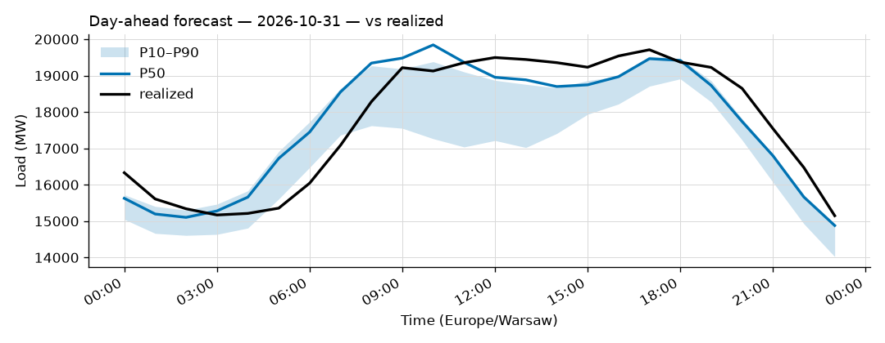
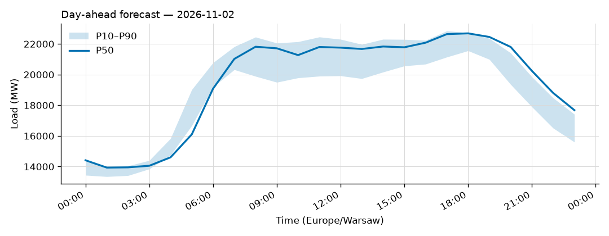

# Daily forecast report — 2026-11-01

Model: seasonal naive — **BASELINE**, not the final model. P50 copies the same hour 7 days ago; the band is the spread of the last 4 weeks. Serves until a trained model earns promotion (see docs/PLAN.md M4, UAT rules M9).

## Yesterday (2026-10-31) — how did we do?

| Forecast | MAPE |
|---|---|
| Ours (naive, incumbent) | 3.49% |
| Challenger (ridge+TSO, shadow) | 1.54% |
| TSO day-ahead | 2.02% |

## Tomorrow (2026-11-02) — the forecast

- Expected peak: **22,691 MW** around 18:00 local time.
- Daily range (P50): 13,936 – 22,691 MW.
- Uncertainty band at peak: 21,556 – 22,728 MW (P10–P90).

### Top drivers (plain words)

Published forecast (seasonal naive): it copies the same hour last week, so its only drivers are last week's load and the day of week (tomorrow is a Monday).

Shadow challenger (ridge + TSO) — measured drivers of tomorrow's forecast (|coef x standardized feature|, exact for a linear model):

1. the TSO's own day-ahead forecast
2. the hour of the day
3. the day of the week

Context: Warsaw temperature tomorrow 6 to 8 °C.

### Oddities

- Price step failed: Cannot have number of splits n_splits=5 greater than the number of samples: n_samples=1.

_Full hourly quantiles: see `data/forecasts/`._
