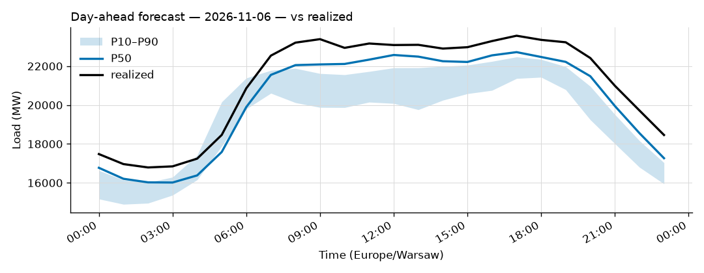
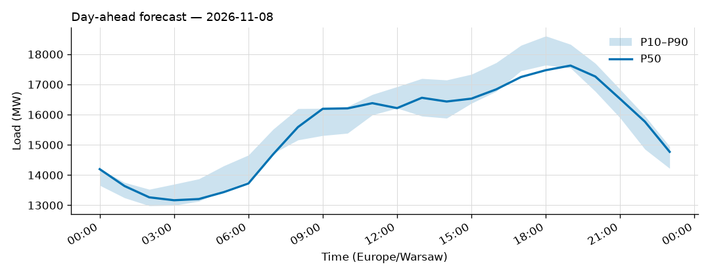

# Daily forecast report — 2026-11-07

Model: seasonal naive — **BASELINE**, not the final model. P50 copies the same hour 7 days ago; the band is the spread of the last 4 weeks. Serves until a trained model earns promotion (see docs/PLAN.md M4, UAT rules M9).

## Yesterday (2026-11-06) — how did we do?

| Forecast | MAPE |
|---|---|
| Ours (naive, incumbent) | 4.24% |
| Challenger (ridge+TSO, shadow) | 1.91% |
| TSO day-ahead | 0.91% |

## Tomorrow (2026-11-08) — the forecast

- Expected peak: **17,626 MW** around 19:00 local time.
- Daily range (P50): 13,166 – 17,626 MW.
- Uncertainty band at peak: 17,545 – 18,329 MW (P10–P90).

### Top drivers (plain words)

Published forecast (seasonal naive): it copies the same hour last week, so its only drivers are last week's load and the day of week (tomorrow is a Sunday).

Shadow challenger (ridge + TSO) — measured drivers of tomorrow's forecast (|coef x standardized feature|, exact for a linear model):

1. the TSO's own day-ahead forecast
2. the hour of the day
3. heating demand (cold below 15°C)

Context: Warsaw temperature tomorrow -1 to 4 °C.

### Oddities

- Price step failed: fit first

_Full hourly quantiles: see `data/forecasts/`._
