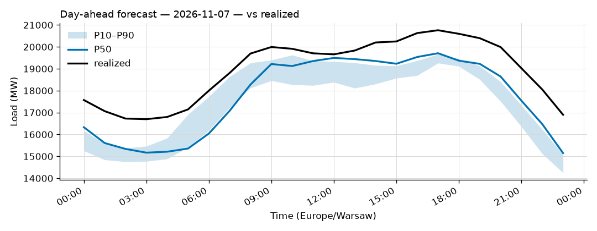
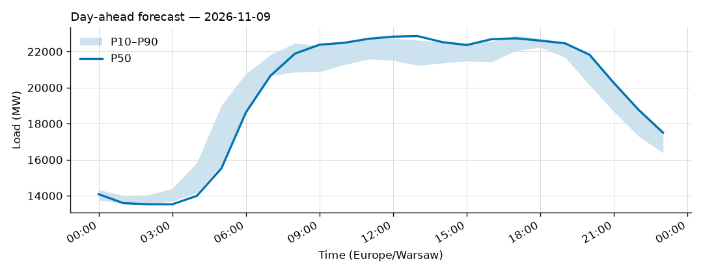
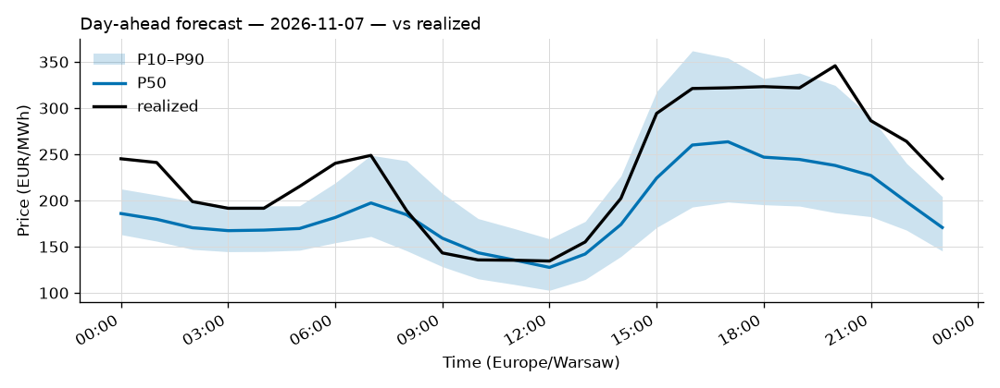
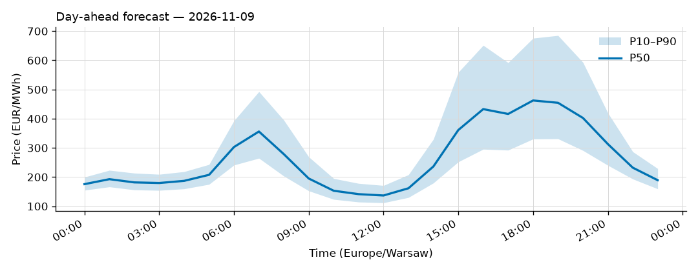

# Daily forecast report — 2026-11-08

Model: seasonal naive — **BASELINE**, not the final model. P50 copies the same hour 7 days ago; the band is the spread of the last 4 weeks. Serves until a trained model earns promotion (see docs/PLAN.md M4, UAT rules M9).

## Yesterday (2026-11-07) — how did we do?

| Forecast | MAPE |
|---|---|
| Ours (naive, incumbent) | 6.56% |
| Challenger (ridge+TSO, shadow) | n/a |
| TSO day-ahead | 2.04% |

## Tomorrow (2026-11-09) — the forecast

- Expected peak: **22,860 MW** around 13:00 local time.
- Daily range (P50): 13,530 – 22,860 MW.
- Uncertainty band at peak: 21,230 – 22,631 MW (P10–P90).

### Top drivers (plain words)

Published forecast (seasonal naive): it copies the same hour last week, so its only drivers are last week's load and the day of week (tomorrow is a Monday).

Context: Warsaw temperature tomorrow -2 to 5 °C.

### Oddities

- Challenger failed: HTTPSConnectionPool(host='api.open-meteo.com', port=443): Read timed out. (read timeout=30)
- Price: RES forecast for 2026-11-09 not yet published (24 h persisted from the day before).

## Price — day-ahead (LEAR, shadow)

### Yesterday (2026-11-07) — forecast vs realized

| Model | MAE (EUR/MWh) |
|---|---|
| LEAR (incumbent) | 44.10 |
| LightGBM+conformal (shadow) | 40.98 |
| naive-1d | 73.73 |

### Tomorrow (2026-11-09) — the price forecast

- Expected peak price: **462 EUR/MWh** around 18:00 local.
- P50 range: 137 – 462 EUR/MWh; band at peak 330 – 676.
- **Spike-risk flag** on 11 hour(s): 06:00, 07:00, 08:00, 15:00, 16:00, 17:00, 18:00, 19:00, 20:00, 21:00, 22:00 local. Historically about 6 in 10 flagged hours became top-5% price hours.

Top drivers of tomorrow's price forecast (measured, |coef x standardized feature| across the 24 hour-models): 1. yesterday's hourly price curve; 2. the TTF gas price; 3. tomorrow's onshore wind forecast.

_Full hourly quantiles: see `data/forecasts/`._
