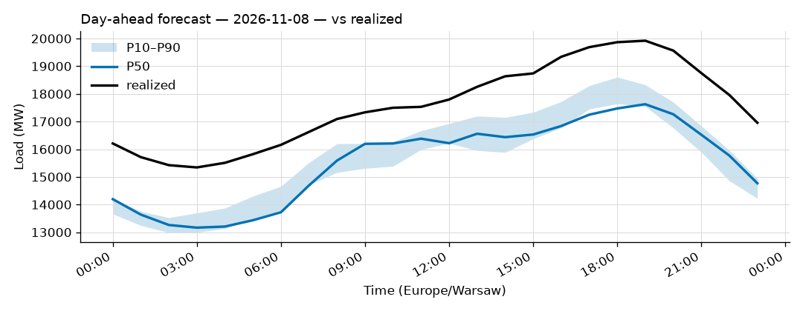
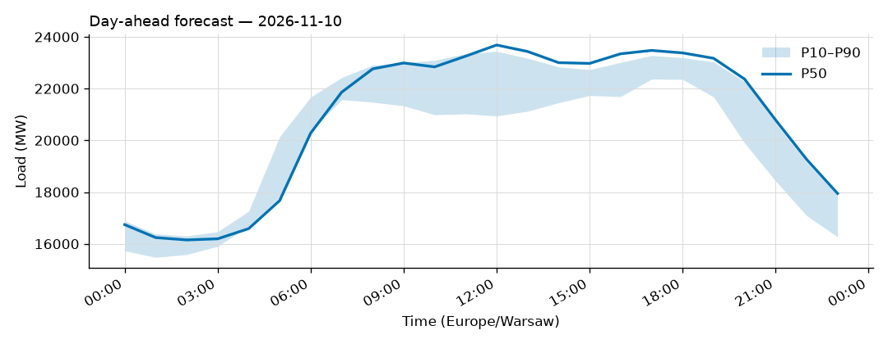

# Daily forecast report — 2026-11-09

Model: seasonal naive — **BASELINE**, not the final model. P50 copies the same hour 7 days ago; the band is the spread of the last 4 weeks. Serves until a trained model earns promotion (see docs/PLAN.md M4, UAT rules M9).

## Yesterday (2026-11-08) — how did we do?

| Forecast | MAPE |
|---|---|
| Ours (naive, incumbent) | 11.63% |
| Challenger (ridge+TSO, shadow) | 3.93% |
| TSO day-ahead | 4.88% |

## Tomorrow (2026-11-10) — the forecast

- Expected peak: **23,685 MW** around 12:00 local time.
- Daily range (P50): 16,150 – 23,685 MW.
- Uncertainty band at peak: 20,942 – 23,440 MW (P10–P90).

### Top drivers (plain words)

Published forecast (seasonal naive): it copies the same hour last week, so its only drivers are last week's load and the day of week (tomorrow is a Tuesday).

Shadow challenger (ridge + TSO) — measured drivers of tomorrow's forecast (|coef x standardized feature|, exact for a linear model):

1. the TSO's own day-ahead forecast
2. the hour of the day
3. heating demand (cold below 15°C)

Context: Warsaw temperature tomorrow -0 to 3 °C.

### Oddities

- Price step failed: price features for 2026-11-10 are all-NaN (first NaN columns: ['ttf_eur_mwh']) — refusing to publish an empty forecast

_Full hourly quantiles: see `data/forecasts/`._
