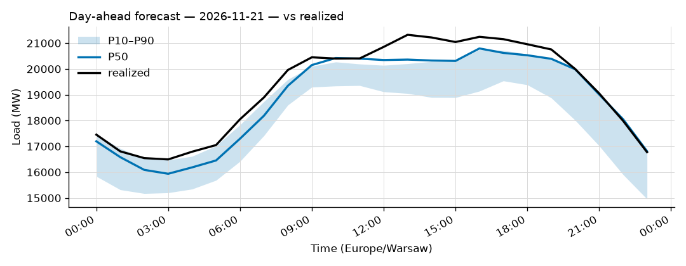
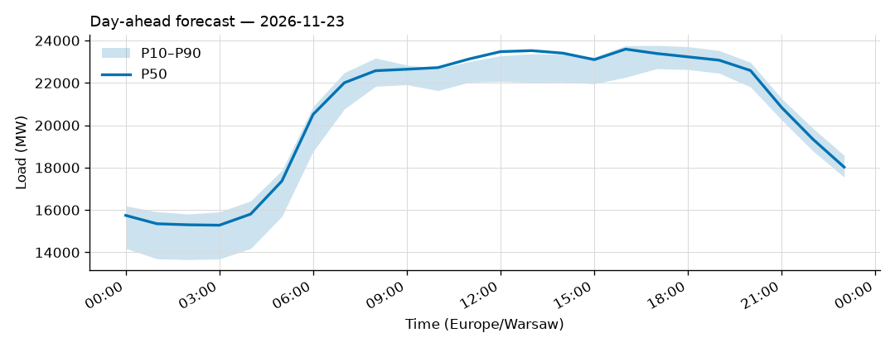
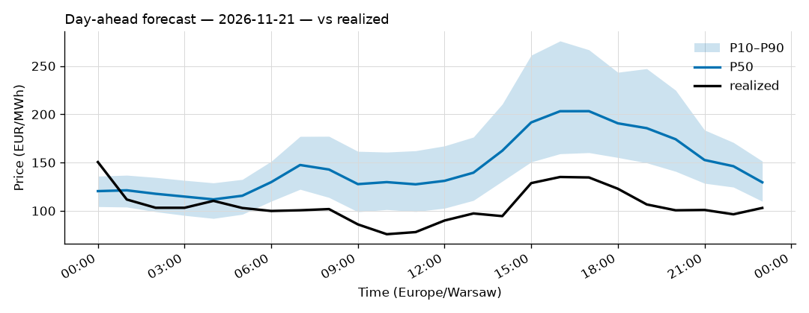
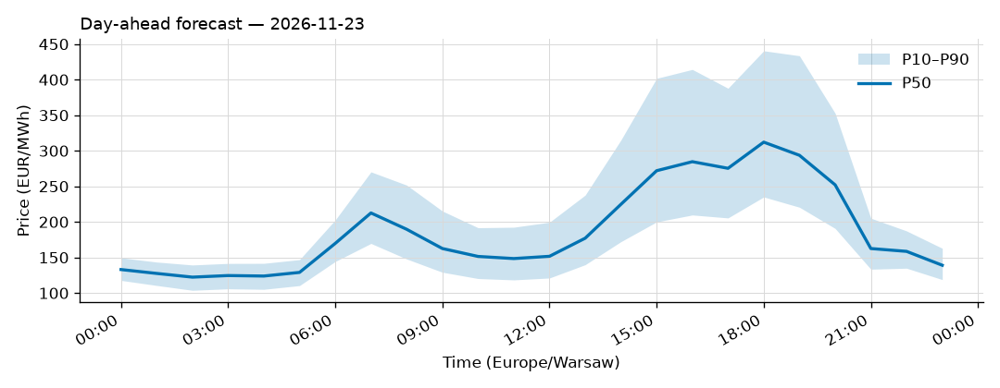

# Daily forecast report — 2026-11-22

Model: seasonal naive — **BASELINE**, not the final model. P50 copies the same hour 7 days ago; the band is the spread of the last 4 weeks. Serves until a trained model earns promotion (see docs/PLAN.md M4, UAT rules M9).

## Yesterday (2026-11-21) — how did we do?

| Forecast | MAPE |
|---|---|
| Ours (naive, incumbent) | 2.19% |
| Challenger (ridge+TSO, shadow) | 1.49% |
| TSO day-ahead | 1.25% |

## Tomorrow (2026-11-23) — the forecast

- Expected peak: **23,595 MW** around 16:00 local time.
- Daily range (P50): 15,282 – 23,595 MW.
- Uncertainty band at peak: 22,263 – 23,754 MW (P10–P90).

### Top drivers (plain words)

Published forecast (seasonal naive): it copies the same hour last week, so its only drivers are last week's load and the day of week (tomorrow is a Monday).

Shadow challenger (ridge + TSO) — measured drivers of tomorrow's forecast (|coef x standardized feature|, exact for a linear model):

1. the TSO's own day-ahead forecast
2. the hour of the day
3. heating demand (cold below 15°C)

Context: Warsaw temperature tomorrow 1 to 2 °C.

### Oddities

- Price: RES forecast for 2026-11-23 not yet published (24 h persisted from the day before).

## Price — day-ahead (LEAR, shadow)

### Yesterday (2026-11-21) — forecast vs realized

| Model | MAE (EUR/MWh) |
|---|---|
| LEAR (incumbent) | 43.40 |
| LightGBM+conformal (shadow) | 56.07 |
| naive-1d | 100.60 |

### Tomorrow (2026-11-23) — the price forecast

- Expected peak price: **312 EUR/MWh** around 18:00 local.
- P50 range: 122 – 312 EUR/MWh; band at peak 235 – 441.
- **Spike-risk flag** on 3 hour(s): 16:00, 17:00, 18:00 local. Historically about 6 in 10 flagged hours became top-5% price hours.

Top drivers of tomorrow's price forecast (measured, |coef x standardized feature| across the 24 hour-models): 1. the TTF gas price; 2. tomorrow's solar generation forecast; 3. the TSO's own day-ahead forecast.

_Full hourly quantiles: see `data/forecasts/`._
