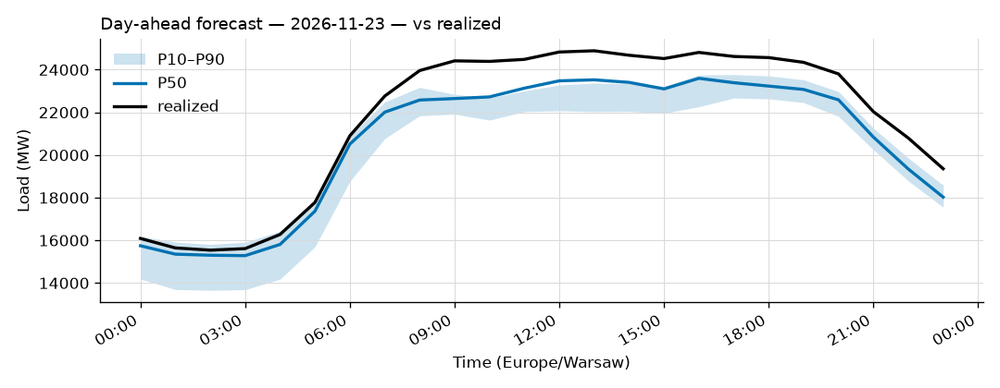
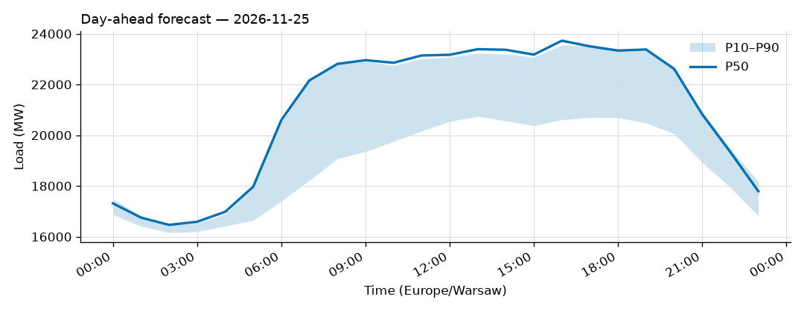
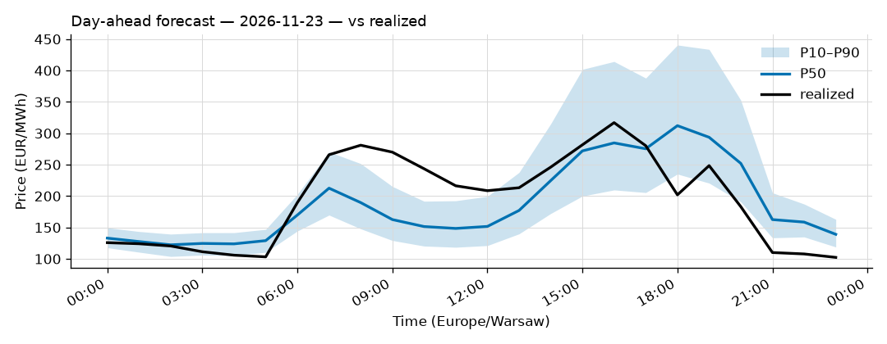
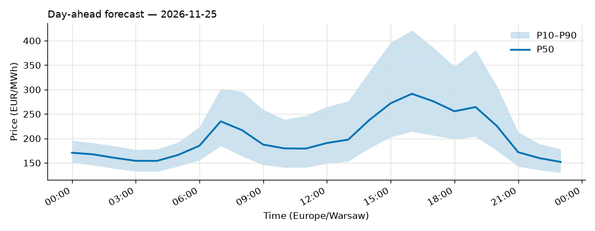

# Daily forecast report — 2026-11-24

Model: seasonal naive — **BASELINE**, not the final model. P50 copies the same hour 7 days ago; the band is the spread of the last 4 weeks. Serves until a trained model earns promotion (see docs/PLAN.md M4, UAT rules M9).

## Yesterday (2026-11-23) — how did we do?

| Forecast | MAPE |
|---|---|
| Ours (naive, incumbent) | 4.59% |
| Challenger (ridge+TSO, shadow) | 2.45% |
| TSO day-ahead | 2.06% |

## Tomorrow (2026-11-25) — the forecast

- Expected peak: **23,725 MW** around 16:00 local time.
- Daily range (P50): 16,467 – 23,725 MW.
- Uncertainty band at peak: 20,611 – 23,557 MW (P10–P90).

### Top drivers (plain words)

Published forecast (seasonal naive): it copies the same hour last week, so its only drivers are last week's load and the day of week (tomorrow is a Wednesday).

Shadow challenger (ridge + TSO) — measured drivers of tomorrow's forecast (|coef x standardized feature|, exact for a linear model):

1. the TSO's own day-ahead forecast
2. the hour of the day
3. heating demand (cold below 15°C)

Context: Warsaw temperature tomorrow -0 to 2 °C.

### Oddities

- Price: RES forecast for 2026-11-25 not yet published (24 h persisted from the day before).

## Price — day-ahead (LEAR, shadow)

### Yesterday (2026-11-23) — forecast vs realized

| Model | MAE (EUR/MWh) |
|---|---|
| LEAR (incumbent) | 42.79 |
| LightGBM+conformal (shadow) | 42.71 |
| naive-1d | 83.98 |

### Tomorrow (2026-11-25) — the price forecast

- Expected peak price: **291 EUR/MWh** around 16:00 local.
- P50 range: 152 – 291 EUR/MWh; band at peak 214 – 421.
- **Spike-risk flag** on 2 hour(s): 15:00, 17:00 local. Historically about 6 in 10 flagged hours became top-5% price hours.

Top drivers of tomorrow's price forecast (measured, |coef x standardized feature| across the 24 hour-models): 1. yesterday's hourly price curve; 2. the TTF gas price; 3. tomorrow's solar generation forecast.

_Full hourly quantiles: see `data/forecasts/`._
