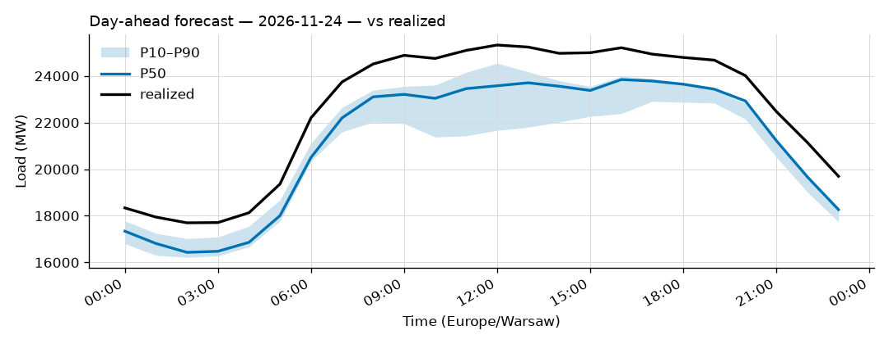
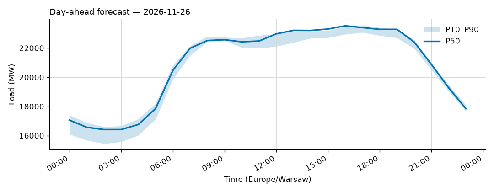
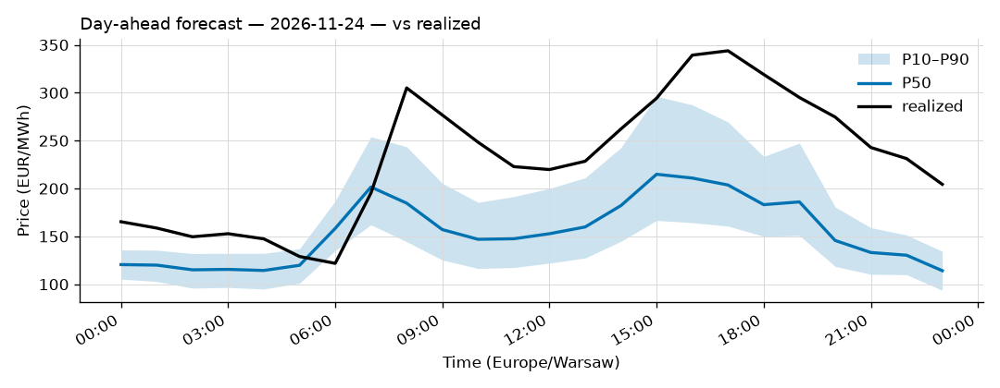
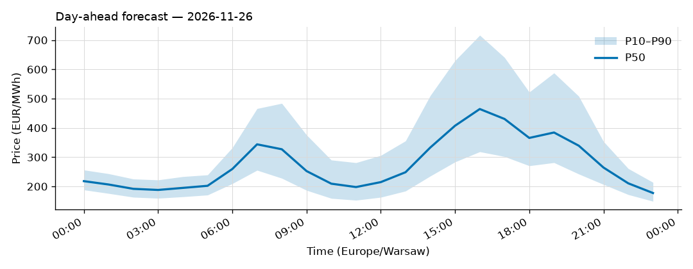

# Daily forecast report — 2026-11-25

Model: seasonal naive — **BASELINE**, not the final model. P50 copies the same hour 7 days ago; the band is the spread of the last 4 weeks. Serves until a trained model earns promotion (see docs/PLAN.md M4, UAT rules M9).

## Yesterday (2026-11-24) — how did we do?

| Forecast | MAPE |
|---|---|
| Ours (naive, incumbent) | 6.21% |
| Challenger (ridge+TSO, shadow) | 3.86% |
| TSO day-ahead | 2.09% |

## Tomorrow (2026-11-26) — the forecast

- Expected peak: **23,522 MW** around 16:00 local time.
- Daily range (P50): 16,413 – 23,522 MW.
- Uncertainty band at peak: 22,940 – 23,483 MW (P10–P90).

### Top drivers (plain words)

Published forecast (seasonal naive): it copies the same hour last week, so its only drivers are last week's load and the day of week (tomorrow is a Thursday).

Shadow challenger (ridge + TSO) — measured drivers of tomorrow's forecast (|coef x standardized feature|, exact for a linear model):

1. the TSO's own day-ahead forecast
2. the hour of the day
3. heating demand (cold below 15°C)

Context: Warsaw temperature tomorrow -2 to 1 °C.

### Oddities

- Price: RES forecast for 2026-11-26 not yet published (24 h persisted from the day before).

## Price — day-ahead (LEAR, shadow)

### Yesterday (2026-11-24) — forecast vs realized

| Model | MAE (EUR/MWh) |
|---|---|
| LEAR (incumbent) | 78.95 |
| LightGBM+conformal (shadow) | 82.69 |
| naive-1d | 47.77 |

### Tomorrow (2026-11-26) — the price forecast

- Expected peak price: **465 EUR/MWh** around 16:00 local.
- P50 range: 178 – 465 EUR/MWh; band at peak 319 – 717.
- **Spike-risk flag** on 16 hour(s): 06:00, 07:00, 08:00, 09:00, 10:00, 12:00, 13:00, 14:00, 15:00, 16:00, 17:00, 18:00, 19:00, 20:00, 21:00, 22:00 local. Historically about 6 in 10 flagged hours became top-5% price hours.

Top drivers of tomorrow's price forecast (measured, |coef x standardized feature| across the 24 hour-models): 1. yesterday's hourly price curve; 2. the TTF gas price; 3. the TSO's own day-ahead forecast.

_Full hourly quantiles: see `data/forecasts/`._
