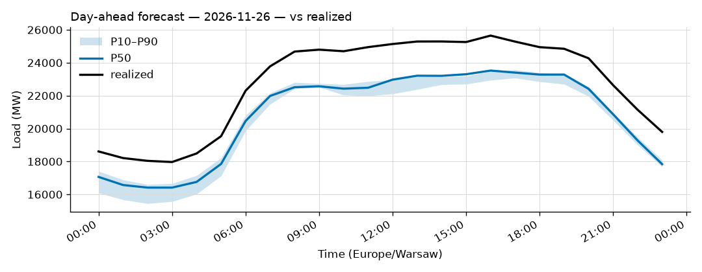
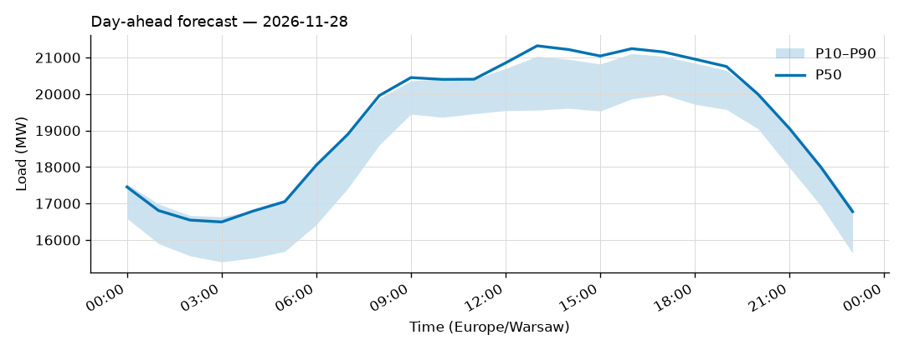
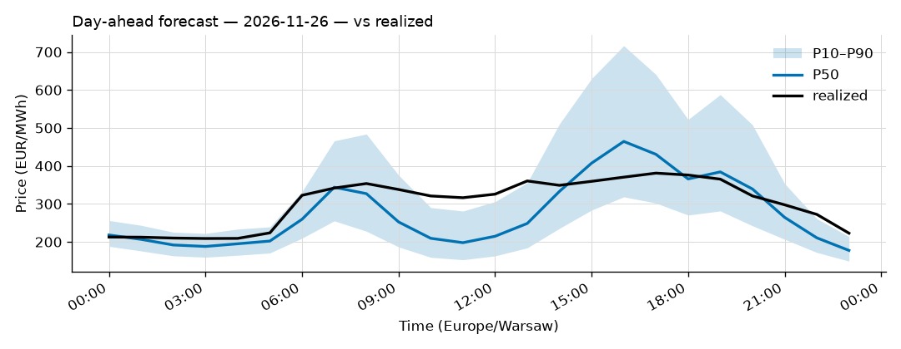
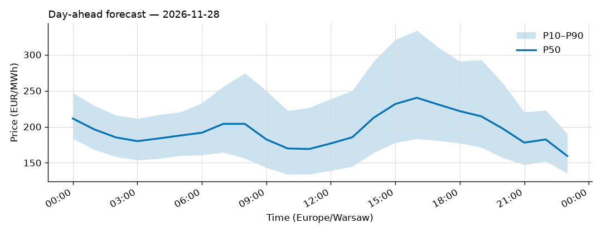

# Daily forecast report — 2026-11-27

Model: seasonal naive — **BASELINE**, not the final model. P50 copies the same hour 7 days ago; the band is the spread of the last 4 weeks. Serves until a trained model earns promotion (see docs/PLAN.md M4, UAT rules M9).

## Yesterday (2026-11-26) — how did we do?

| Forecast | MAPE |
|---|---|
| Ours (naive, incumbent) | 8.39% |
| Challenger (ridge+TSO, shadow) | 0.70% |
| TSO day-ahead | 1.32% |

## Tomorrow (2026-11-28) — the forecast

- Expected peak: **21,322 MW** around 13:00 local time.
- Daily range (P50): 16,494 – 21,322 MW.
- Uncertainty band at peak: 19,559 – 21,034 MW (P10–P90).

### Top drivers (plain words)

Published forecast (seasonal naive): it copies the same hour last week, so its only drivers are last week's load and the day of week (tomorrow is a Saturday).

Shadow challenger (ridge + TSO) — measured drivers of tomorrow's forecast (|coef x standardized feature|, exact for a linear model):

1. the TSO's own day-ahead forecast
2. heating demand (cold below 15°C)
3. the hour of the day

Context: Warsaw temperature tomorrow -6 to -2 °C.

### Oddities

- Price: RES forecast for 2026-11-28 not yet published (24 h persisted from the day before).

## Price — day-ahead (LEAR, shadow)

### Yesterday (2026-11-26) — forecast vs realized

| Model | MAE (EUR/MWh) |
|---|---|
| LEAR (incumbent) | 46.29 |
| LightGBM+conformal (shadow) | 31.26 |
| naive-1d | 36.16 |

### Tomorrow (2026-11-28) — the price forecast

- Expected peak price: **240 EUR/MWh** around 16:00 local.
- P50 range: 160 – 240 EUR/MWh; band at peak 183 – 334.
- **Spike-risk flag** on 6 hour(s): 08:00, 09:00, 13:00, 14:00, 15:00, 16:00 local. Historically about 6 in 10 flagged hours became top-5% price hours.

Top drivers of tomorrow's price forecast (measured, |coef x standardized feature| across the 24 hour-models): 1. yesterday's hourly price curve; 2. the TTF gas price; 3. tomorrow's solar generation forecast.

_Full hourly quantiles: see `data/forecasts/`._
